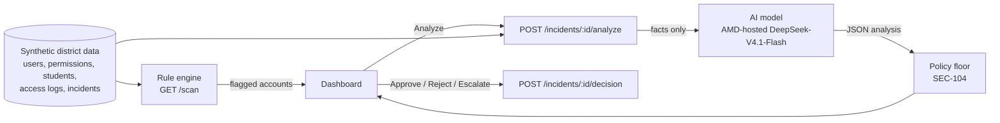

# EduGuard Agent

**AI security and compliance for educational institutions.** EduGuard Agent finds risky access to student data, explains each risk in plain language, recommends a fix, and leaves the final decision to a human administrator.

Built by **Team SentrX** for the **AMD Developer Hackathon: ACT III**.

**Live demo:** https://eduguardagentpro.vercel.app/

> All data in this project is **synthetic** (a fictional school district). No real student records are used.

---

## Table of contents

1. [What it does](#1-what-it-does)
2. [Walkthrough of the app](#2-walkthrough-of-the-app)
3. [The five case scenarios](#3-the-five-case-scenarios)
4. [How it works](#4-how-it-works)
5. [AMD usage](#5-amd-usage)
6. [Tech stack](#6-tech-stack)
7. [Repository structure](#7-repository-structure)
8. [Getting started](#8-getting-started)
9. [Configuration](#9-configuration)
10. [API reference](#10-api-reference)
11. [Deployment notes](#11-deployment-notes)
12. [Safety and design principles](#12-safety-and-design-principles)
13. [Known limitations](#13-known-limitations)
14. [Team](#14-team)
15. [License](#15-license)

---

## 1. What it does

School administrators hold sensitive student data but cannot read every access log. Risk hides in ordinary activity: a former employee whose account is still enabled, a teacher with administrator-level permissions, a contractor who can see students in another district.

EduGuard Agent:

- **Detects** risky access with a deterministic rule engine that runs instantly, with no model call.
- **Explains** each finding in plain language, with the specific evidence behind it, using an AI model.
- **Recommends** one concrete remediation per finding.
- **Hands the decision to a human.** An administrator approves, rejects or escalates. Recording a decision never changes any account automatically.

**Intended user:** a school or district administrator responsible for data access and compliance.

## 2. Walkthrough of the app

| Step | Page | What you see |
|---|---|---|
| 1 | **Login** | Email and password sign-in for administrators. |
| 2 | **Sign up** | New administrators register with first name, last name, email and a confirmed password (minimum 8 characters). |
| 3 | **Dashboard** | Summary counts of flagged accounts by severity, a severity filter (low, medium, high, critical) and a ranked table of flagged accounts. The flagged list comes from the rule scan, so it loads instantly. |
| 4 | **Analyze an incident** | Select an incident and run the analysis. The card shows the risk level, a confidence score, a plain-language explanation, the recommended mitigation, the technical evidence, and which model produced the analysis. |
| 5 | **Decision** | The administrator approves, rejects or escalates, optionally with a note. The decision is recorded and nothing is executed. |
| 6 | **About Us** | The project's mission, three design pillars (student data privacy, AI security intelligence, human-in-the-loop safety) and the five-person Team SentrX cards, which are editable in the page. |

## 3. The five case scenarios

The dashboard ships with five seeded incidents in the synthetic district. They are the demo scenarios.

| # | Scenario | What happens | Rule | Severity | Recommended direction |
|---|---|---|---|---|---|
| 1 | Former employee, still active | Employment is inactive but the account is enabled and was used to view a student record. | Departed Employee Access | Critical | Disable the account, revoke sessions, investigate recent activity, verify offboarding. |
| 2 | Excessive permissions | A teacher account holds administrator-level permissions. | Static Permission Privilege Mismatch | High | Remove extra privileges and restore least-privilege access. |
| 3 | Out-of-class access | A staff member opens a student outside their assigned classes. | Out-of-Class Student Record Access | High | Verify whether an exception exists, then restrict to assigned classes. |
| 4 | Bulk export | One teacher exports student records many times within minutes. | Rapid Bulk Record Download | High | Confirm identity and purpose, check for data exposure. |
| 5 | Vendor outside its district | A contractor limited to one district views a student in another. | Cross-District Vendor Boundary Violation | Critical | Block access, review permissions, revoke credentials if needed, investigate exposure. |

## 4. How it works



**Rule engine (`GET /scan`).** Eight deterministic rules run over every user and return flagged accounts with a severity. There is no model call, so results are immediate.

| Rule | Severity |
|---|---|
| Departed Employee Access | Critical |
| Cross-District Vendor Boundary Violation | Critical |
| Out-of-Class Student Record Access | High |
| Unauthorized Record Access (record viewing not permitted) | High |
| Static Permission Privilege Mismatch (teacher with administrator level) | High |
| Rapid Bulk Record Download (10 or more successful accesses within 15 minutes) | High |
| Denied Access Attempt | Medium |
| After-Hours Record Access | Low |

**AI analysis (`POST /incidents/:id/analyze`).** The server builds an event from raw facts (user, permissions, access summary, access logs) and sends it to the model. The model returns a risk level, evidence, explanation, recommended action and confidence.

**Engine selection.** The server picks the analysis engine from the environment:

1. If `ANALYSIS_PROVIDER` is `amd` (the default when `AMD_API_KEY` is set), it calls the AMD-hosted model.
2. Otherwise, if `GEMINI_API_KEY` is set, it calls Gemini Flash, and falls back to AMD if Gemini fails and an AMD key exists.
3. If no model is configured, or the call fails, it uses the **deterministic policy engine**, which writes a template-based analysis from the event facts. The stored record then says `provider: policy_engine` or `policy_engine_fallback`, plus a `fallback_reason`.

Every stored analysis records which `provider` and `model` produced it, so you can always see which path ran.

**Policy floor (District Policy SEC-104).** After the analysis, a compliance floor guarantees a minimum severity: departed-employee access and cross-district boundary crossings can never be rated below high, and are raised to critical. SEC-104 is a policy label defined inside this project's fictional district.

**Human in the loop.** `POST /incidents/:id/decision` stores approve, reject or escalate with the administrator's name, an optional note and a timestamp. It does not modify accounts or permissions.

## 5. AMD usage

The AI analysis runs on a model **hosted on AMD infrastructure**, reached through the event's AMD Token Factory API.

- **Model:** `DeepSeek-V4.1-Flash` (open model, set with `AMD_MODEL`).
- **Endpoint:** set with `AMD_BASE_URL` (default `https://developer.amd.com.cn/radeon/api/v1`), authenticated with `AMD_API_KEY`.
- **Call:** an OpenAI-compatible `POST {AMD_BASE_URL}/chat/completions` made by the server in `server.ts`.

**How to verify AMD ran an analysis.** Open the Dashboard, analyze an incident, and read the model attribution on the result card. It should show the DeepSeek model with provider `amd_direct`. `GET /health` also reports `amd_direct_configured` and `analysis_provider`. If the card shows Gemini or the policy engine instead, the AMD key is missing or the call failed; check the `fallback_reason`.

## 6. Tech stack

| Layer | Technology |
|---|---|
| Frontend | React 19, TypeScript, Vite, Tailwind CSS 4, Motion, Lucide icons |
| Server | Node.js, Express, TypeScript (run with `tsx`) |
| AI | AMD-hosted DeepSeek-V4.1-Flash (primary), Google Gemini Flash (optional), deterministic policy engine (fallback) |
| Auth | PBKDF2 (SHA-256, 100,000 iterations) password hashing, random bearer session tokens |
| Data | Synthetic JSON files (users, permissions, students, access logs, incidents, accounts) |
| Reference backend | Python 3 and FastAPI implementation of the same API, in `backend/` (not used by the deployed app) |

## 7. Repository structure

```
.
├── server.ts                 Express server: auth, rule engine, analysis, decisions, data API,
│                             and (in production) serves the built frontend from dist/
├── index.html                Vite entry
├── vite.config.ts
├── package.json
├── .env.example              Environment variable template
├── src/
│   ├── main.tsx, App.tsx
│   ├── pages/                Login, Signup, Dashboard, AboutUs
│   ├── components/           Navbar, Footer, SeverityBadge, EduGuardLogo, CloudyAtmosphere
│   ├── context/AuthContext.tsx
│   ├── services/api.ts       Calls to the server API
│   └── types/index.ts
└── backend/                  Python (FastAPI) reference implementation + synthetic data + tests
    ├── app/                  main.py, auth.py, models.py, store.py
    ├── data/                 users, permissions, students, access_logs, incidents, accounts (JSON)
    ├── tools/generate_data.py
    ├── tests/                pytest suite
    └── postman/, eduguard-openapi.json
```

## 8. Getting started

### Prerequisites

- Node.js 20 or newer and npm
- (Optional) An AMD Token Factory API key, to run the AI analysis on the AMD-hosted model

### Install and run (development)

```bash
npm install
cp .env.example .env        # Windows PowerShell: copy .env.example .env
# edit .env and set AMD_API_KEY (see Configuration)
npm run dev
```

Open http://localhost:3000. The development server runs Express and Vite together, so the API and the frontend share one address.

### Build and run (production mode)

```bash
npm run build
NODE_ENV=production npm start      # PowerShell: $env:NODE_ENV="production"; npm start
```

With `NODE_ENV=production`, the server serves the built frontend from `dist/` and the API from the same port.

### Type-check

```bash
npm run lint
```

### Run the reference Python backend (optional)

```bash
cd backend
python -m venv .venv
# macOS/Linux: source .venv/bin/activate    Windows: .venv\Scripts\activate
pip install -r requirements.txt
uvicorn app.main:app --reload --port 8000
pytest -q
```

Interactive API docs at http://127.0.0.1:8000/docs.

### First sign-in

The server seeds one demo administrator account for reviewers, and the Login page has a demo-fill button. You can also create your own account on the Sign up page. Replace or remove the seeded account before any real use (see [Known limitations](#13-known-limitations)).

## 9. Configuration

Copy `.env.example` to `.env`. Never commit `.env`; it is already in `.gitignore`.

| Variable | Required | Purpose |
|---|---|---|
| `AMD_API_KEY` | For AMD analysis | Token Factory API key. Keep it on the server only. |
| `AMD_BASE_URL` | No | AMD endpoint. Default `https://developer.amd.com.cn/radeon/api/v1`. |
| `AMD_MODEL` | No | Model name. Default `DeepSeek-V4.1-Flash`. |
| `ANALYSIS_PROVIDER` | No | `amd` to force the AMD model. When unset, the server uses AMD if `AMD_API_KEY` is set, otherwise Gemini. |
| `GEMINI_API_KEY` | No | Optional Gemini Flash engine. |
| `PORT` | No | Server port. Default `3000`. |
| `NODE_ENV` | No | Set to `production` to serve the built frontend. |
| `VITE_API_BASE_URL` | No | API address for the frontend. Empty means same origin (full-stack deployment). |
| `APP_URL` | No | Public URL of the app (used by AI Studio hosting). |

**Security:** only variables prefixed with `VITE_` reach the browser. Never put an API key in a `VITE_` variable.

## 10. API reference

Base URL is the server address (for example `http://localhost:3000`). IDs are case-insensitive.

**Authentication**

| Method | Path | Description |
|---|---|---|
| POST | `/auth/signup` | Create an account (`first_name`, `last_name`, `email`, `password`). |
| POST | `/auth/login` | Sign in; returns a bearer token. |
| POST | `/auth/logout` | End the session. |
| GET | `/auth/me` | Current user (requires `Authorization: Bearer <token>`). |

**Security analysis**

| Method | Path | Description |
|---|---|---|
| GET | `/scan?min_severity=low\|medium\|high\|critical` | Run the rule engine over all users. No model call. |
| GET | `/incidents`, `/incidents/:id` | Seeded incidents. |
| POST | `/incidents/:id/analyze` | Run the AI analysis for one incident and store it. |
| GET | `/incidents/:id/analysis`, `/analyses` | Stored analysis and decision. |
| POST | `/incidents/:id/decision` | Body `{"decision": "approve"\|"reject"\|"escalate", "decided_by": "...", "note": "..."}`. |

**District data and health**

| Method | Path | Description |
|---|---|---|
| GET | `/users`, `/users/:id` | Staff accounts. |
| GET | `/permissions`, `/permissions/:id` | Permission records. |
| GET | `/students`, `/students/:id` | Student records. |
| GET | `/access-logs`, `/access-logs/:id` | Access logs, with filters. |
| GET | `/health` | Record counts, integrity issues, and which AI engines are configured. |
| POST | `/reload` | Reload the data files. |

Example:

```bash
curl "http://localhost:3000/scan?min_severity=high"
curl -X POST http://localhost:3000/incidents/I001/analyze
```

## 11. Deployment notes

`server.ts` is a **long-running Node process** that serves both the API and the frontend. It runs as-is on hosts that run Node servers (a VM, Render, Railway, Fly.io, Google Cloud Run and similar): build, set the environment variables, set `NODE_ENV=production`, and run `npm start`.

On **Vercel**, which runs serverless functions rather than a persistent Express process, be aware that:

- Sessions, stored analyses and administrator decisions are kept **in memory**, so they can reset between requests or deployments.
- Sign-up writes to `accounts.json` on disk, which is not persistent on serverless platforms, so newly created accounts may not survive.
- Set `AMD_API_KEY` (and optionally `AMD_MODEL` and `ANALYSIS_PROVIDER=amd`) as environment variables in the project settings. Without them, the app falls back to the policy engine and the AMD model is not used.

For durable state, replace the in-memory stores and JSON files with a database.

## 12. Safety and design principles

- **The AI recommends; a human decides.** No code path executes a remediation.
- **Evidence first.** Each finding shows the specific facts behind it.
- **Uncertainty is visible.** Each analysis carries a confidence score.
- **Deterministic floor.** Rules guarantee a minimum severity for the most serious cases, so the model cannot under-rate them.
- **Transparent provenance.** Each analysis records which provider and model produced it, and why a fallback was used.
- **Synthetic data only.** The prototype never touches real student records.

## 13. Known limitations

This is a hackathon prototype. Please read these before relying on it.

- **API endpoints are not authenticated.** Login gates the interface, but on the server only `/auth/me` checks the bearer token. The data, analysis and decision endpoints are open. Add authentication middleware before any real use.
- **Demo account.** A seeded administrator account and a demo-fill button exist for reviewers. Remove them for real deployments.
- **In-memory state.** Sessions, analyses and decisions are lost when the server restarts.
- **Template analysis when AI is unavailable.** The policy-engine fallback writes analyses from templates tuned to the five seeded incidents (one branch is keyed to an incident ID). It is not model output and should not be presented as such.
- **Rules tuned to synthetic data.** Thresholds were chosen for this district, so agreement with the seeded scenarios is by design, not an independent accuracy measurement.
- **Model speed varies.** The shared AMD endpoint can take from a few seconds to about a minute. The UI shows a loading state; be patient.
- **Not a compliance certification.** EduGuard is decision-support software. It does not by itself make an institution compliant with any regulation.

## 14. Team

**Team SentrX**

| Member | Focus |
|---|---|
| Muhammad Asim (team leader) | AMD model and AI integration |
| L.E | Product, security scenarios, integration and submission |
| Ayesha and Khizer | Synthetic data and backend |
| Minha | Dashboard and demo UI |

 
